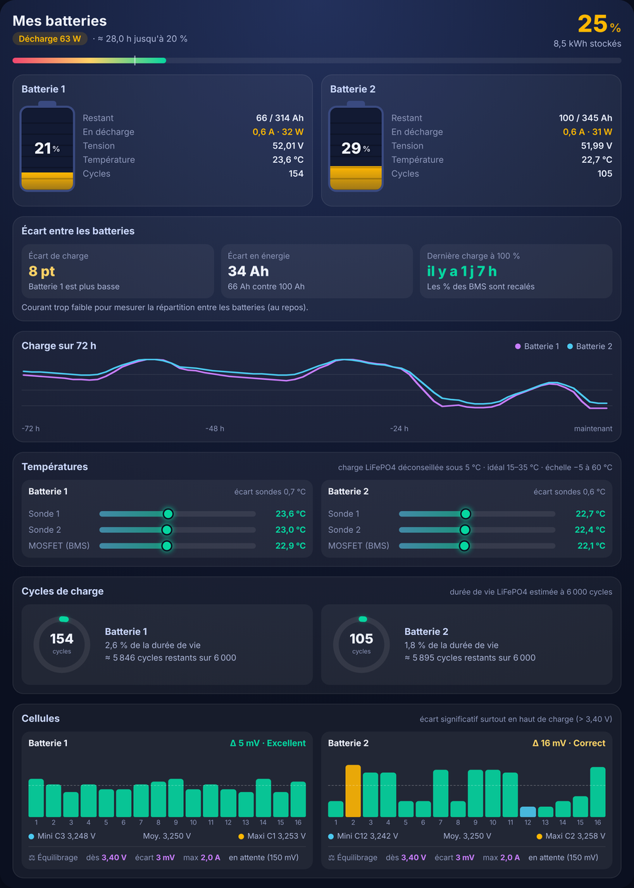
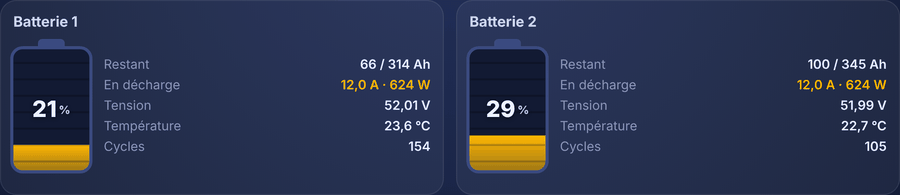
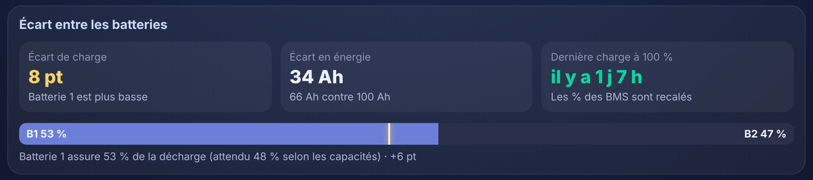
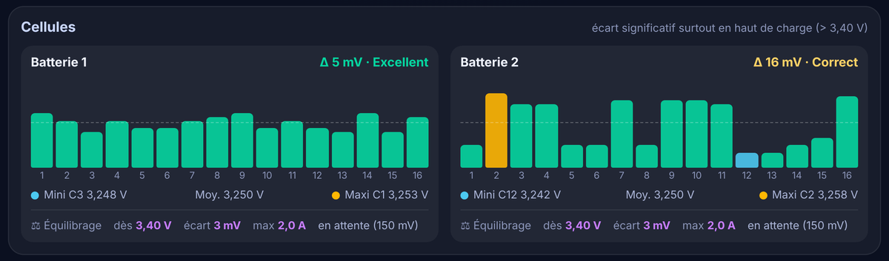

# Batteries Duo Card

Une carte Home Assistant pour comparer deux batteries LiFePO4 (ou plus) branchées en parallèle, chacune avec son JK-BMS.

🇬🇧 English version: [README.md](README.md)

🎬 La vidéo : [2 batteries en parallèle : pourquoi l'une se vide toujours plus vite ?](https://youtu.be/lwJmwtKwEvQ)

<p align="center"></p>

## Pourquoi

Avec deux batteries en parallèle, il y en a souvent une qui se vide plus vite que l'autre. Un tableau de bord classique affiche plein de chiffres, mais ne compare jamais les deux. Cette carte les met côte à côte et montre **l'écart entre elles, et d'où il vient**.

## Ce qu'elle affiche

- **Jauges animées** : les traits montent en charge et descendent en décharge.
- **Écart entre les batteries** : écart de charge en points, écart en Ah, et temps écoulé depuis la dernière charge à 100 % (le moment où les deux BMS recalent leur %).
- **Répartition réelle du courant** : quand du courant passe, la part que fournit vraiment chaque batterie, comparée à ce que prévoit sa capacité.
- **Courbe de charge sur 72 h** des deux batteries, à partir des statistiques de Home Assistant.
- **Températures** : les deux sondes et le MOSFET du BMS de chaque batterie, en couleur (la charge sous 5 °C est signalée).
- **Cycles de charge**, avec un anneau qui montre la part de la durée de vie déjà consommée.
- **Les 16 cellules** en barres : la plus basse en bleu, la plus haute en orange, l'écart en mV et un verdict.
- **Réglages d'équilibrage** (tension de démarrage, écart de déclenchement, courant max) et l'état de l'équilibreur (actif ou en attente).

<p align="center"></p>
<p align="center"></p>
<p align="center"></p>

## Prérequis

Les données de tes JK-BMS dans Home Assistant grâce au composant ESPHome [esphome-jk-bms](https://github.com/syssi/esphome-jk-bms) (Bluetooth `jk_bms_ble` ou RS485). Pour lire deux JK-BMS avec un seul ESP32, voir [esp32-2-jk-bms](https://github.com/letslooger/esp32-2-jk-bms).

## Installation

1. Copie `batteries-duo-card.js` dans le dossier `/config/www/` de Home Assistant.
2. Paramètres > Tableaux de bord > ⋮ > Ressources > Ajouter une ressource :
   - URL : `/local/batteries-duo-card.js?v=1`
   - Type : Module JavaScript
3. Sur ton tableau de bord : Modifier > Ajouter une carte > Manuel, puis colle le contenu de `exemple_config.yaml`.
4. Indique le `prefix` de chaque batterie (le début du nom de ses entités) et enregistre.

Astuce : la carte est plus belle dans une vue de type « Panneau (1 carte) ».

## Autres batteries (Deye, Pylontech, BMS lu en Modbus…)

La carte est pensée pour les noms d'entités du composant esphome-jk-bms, mais elle marche avec n'importe quelle batterie : à la place du `prefix`, indique tes propres entités dans `entities`. Seule `state_of_charge` est obligatoire, les autres sont facultatives (un bloc sans données reste vide).

```yaml
type: custom:batteries-duo-card
batteries:
  - name: Batterie 1
    entities:
      state_of_charge: sensor.deye_batterie_1_soc
      current: sensor.deye_batterie_1_courant
      total_voltage: sensor.deye_batterie_1_tension
      temperature_sensor_1: sensor.deye_batterie_1_temperature
      charging_cycles: sensor.deye_batterie_1_cycles
      capacity_remaining: sensor.deye_batterie_1_capacite_restante   # en Ah
      full_charge_capacity: sensor.deye_batterie_1_capacite          # en Ah
      cell_voltage_1: sensor.deye_batterie_1_cellule_1               # … jusqu'à cell_voltage_16
  - name: Batterie 2
    entities:
      state_of_charge: sensor.deye_batterie_2_soc
      current: sensor.deye_batterie_2_courant
```

Remplace ces noms par les tiens : Paramètres > Appareils et services > Entités, puis clique sur l'entité et la roue dentée pour voir son « ID d'entité ». Tu peux aussi mélanger les deux : un `prefix` et quelques `entities` pour remplacer seulement celles qui ont un autre nom.

Clés possibles : `state_of_charge`, `capacity_remaining`, `full_charge_capacity`, `current`, `power`, `total_voltage`, `temperature_sensor_1`, `temperature_sensor_2`, `mosfet_temperature`, `charging_cycles`, `balancing_current`, `delta_cell_voltage`, `cell_voltage_1` à `cell_voltage_16`, `balancing` et `online_status` (binary_sensor), `charging` et `discharging` (switch).

## Afficher les réglages d'équilibrage

La carte peut afficher les réglages d'équilibrage du BMS si ta configuration ESPHome les expose en entités `number`, par exemple :

```yaml
number:
  - platform: jk_bms_ble
    jk_bms_ble_id: bms0
    balancing_start_voltage:
      name: "BMS 1 Tension demarrage equilibrage"
    balance_trigger_voltage:
      name: "BMS 1 Ecart declenchement equilibrage"
    max_balance_current:
      name: "BMS 1 Courant equilibrage max"
```

Indique ensuite ces entités dans `balance_start`, `balance_trigger` et `balance_current`. Attention : modifier ces valeurs dans Home Assistant les écrit directement dans le BMS.

## Mise à jour

Remplace le contenu de `/config/www/batteries-duo-card.js`, puis dans Paramètres > Tableaux de bord > Ressources, augmente le numéro de l'URL (`?v=1` devient `?v=2`) et recharge la page.

## Dépannage

**« Custom element doesn't exist: batteries-duo-card »** : Home Assistant ne trouve pas le fichier de la carte. Vérifie dans l'ordre :
1. Le fichier est bien dans `/config/www/` et s'appelle exactement `batteries-duo-card.js` (pas `batteries-duo-card.js.txt`, pas `batteries-duo-card (1).js`).
2. C'est le vrai fichier : sur GitHub, ouvre `batteries-duo-card.js` puis clique sur le bouton de téléchargement (« Download raw file »). Un « clic droit > Enregistrer sous » sur la page GitHub enregistre une page web, pas la carte. Le fichier doit commencer par `/*` et faire environ 28 Ko.
3. Si tu viens de créer le dossier `www`, redémarre Home Assistant (Paramètres > Système > Redémarrer) : il ne voit ce dossier qu'au démarrage.
4. La ressource existe bien : Paramètres > Tableaux de bord > ⋮ > Ressources, URL `/local/batteries-duo-card.js?v=1`, type « Module JavaScript ».
5. Vide le cache : Ctrl + F5 sur ordinateur. Sur l'appli téléphone : Paramètres de l'appli > Débogage > Réinitialiser le cache du frontend.

Test rapide : ouvre `http://<adresse-de-ton-home-assistant>:8123/local/batteries-duo-card.js` dans ton navigateur. Tu dois voir du code qui commence par `/*`. Si tu as une erreur 404, le fichier n'est pas au bon endroit.

**« Batterie 1 : indique un prefix ou des entities »** : chaque batterie a besoin d'un `prefix`, ou d'au moins `entities: state_of_charge`.

**« Courant trop faible pour mesurer la répartition »** : c'est normal au repos. La répartition ne s'affiche que si les deux batteries chargent ou déchargent avec au moins 3 A au total.

**La courbe 72 h ou « Dernière charge à 100 % » reste vide** : les capteurs de charge doivent avoir des statistiques long terme (`state_class: measurement`), ce qu'ESPHome fait par défaut.
