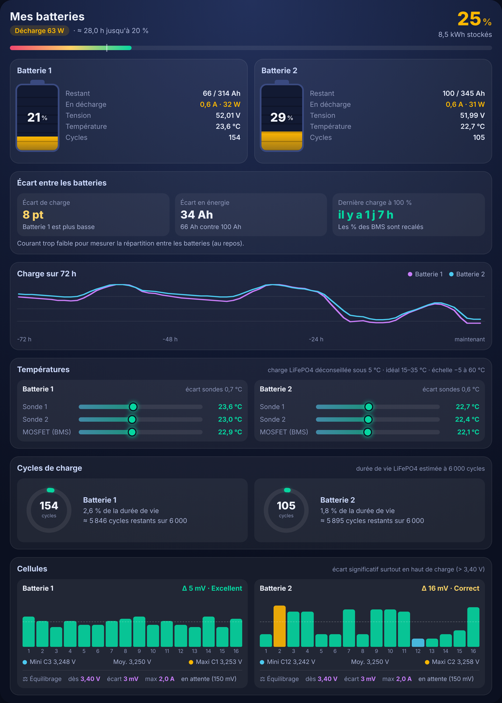
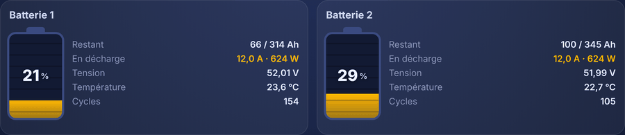
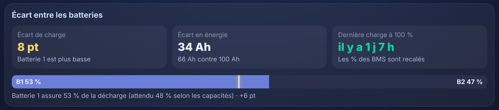
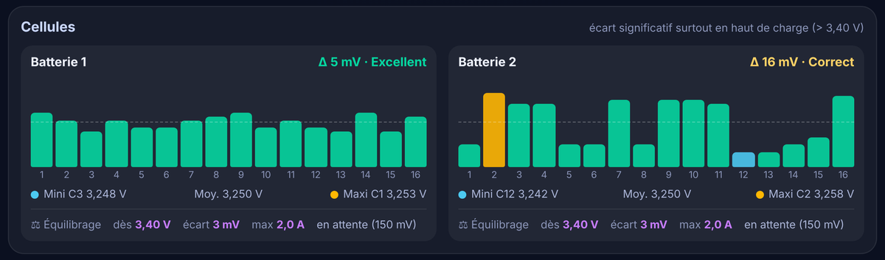

# Batteries Duo Card

A Home Assistant card to compare two (or more) LiFePO4 batteries in parallel, each with its own JK-BMS.

🇫🇷 Version française : [LISEZMOI.md](LISEZMOI.md)

🎬 Video (in French): [2 batteries in parallel: why does one always drain faster?](https://youtu.be/lwJmwtKwEvQ)

<p align="center"></p>

## Why

With two batteries in parallel, one often drains faster than the other. A classic dashboard shows plenty of numbers but never compares the two packs. This card puts them side by side and shows **how far apart they are, and why**.

## Features

- **Animated battery gauges**: stripes move up while charging, down while discharging.
- **Gap between the batteries**: state-of-charge gap in points, energy gap in Ah, and time since the last full charge (the moment both BMS recalibrate their %).
- **Real current share**: while current flows, the share each battery actually delivers, compared with what its capacity says it should.
- **72-hour state-of-charge chart** for both batteries, from Home Assistant statistics.
- **Temperatures**: both probes and the BMS MOSFET for each battery, colour-coded (charging LiFePO4 below 5 °C is flagged).
- **Charge cycles** with a ring showing how much of the rated lifespan is used.
- **All 16 cells** as bars, lowest in blue, highest in orange, with the delta in mV and a verdict.
- **Balancing settings** (start voltage, trigger delta, max current) and whether the balancer is active or waiting.

<p align="center"></p>
<p align="center"></p>
<p align="center"></p>

## Requirements

Your JK-BMS data in Home Assistant through the ESPHome component [esphome-jk-bms](https://github.com/syssi/esphome-jk-bms) (Bluetooth `jk_bms_ble` or RS485). To read two JK-BMS with a single ESP32, see [esp32-2-jk-bms](https://github.com/letslooger/esp32-2-jk-bms).

## Installation

1. Copy `batteries-duo-card.js` into Home Assistant's `/config/www/` folder.
2. Settings > Dashboards > ⋮ > Resources > Add resource:
   - URL: `/local/batteries-duo-card.js?v=1`
   - Type: JavaScript module
3. On your dashboard: Edit > Add card > Manual, then paste the content of `exemple_config.yaml`.
4. Set each battery's `prefix` (the start of its entity names) and save.

Tip: the card looks best on a "Panel (1 card)" view.

## Showing the balancing settings

The card can display the BMS balancing settings if your ESPHome config exposes them as `number` entities, for example:

```yaml
number:
  - platform: jk_bms_ble
    jk_bms_ble_id: bms0
    balancing_start_voltage:
      name: "BMS 1 Tension demarrage equilibrage"
    balance_trigger_voltage:
      name: "BMS 1 Ecart declenchement equilibrage"
    max_balance_current:
      name: "BMS 1 Courant equilibrage max"
```

Then point `balance_start`, `balance_trigger` and `balance_current` to these entities in the card config. Careful: changing these values in Home Assistant writes them to the BMS.

## Updating

Replace the content of `/config/www/batteries-duo-card.js`, then in Settings > Dashboards > Resources bump the URL number (`?v=1` becomes `?v=2`) and reload.

## Troubleshooting

**"Courant trop faible pour mesurer la répartition"**: normal at rest. The current share only shows when both batteries charge or discharge with at least 3 A in total.

**The 72-hour chart or "last full charge" is empty**: the state-of-charge sensors need long-term statistics (`state_class: measurement`), which ESPHome sets by default.

Note: the card's on-screen labels are in French.
